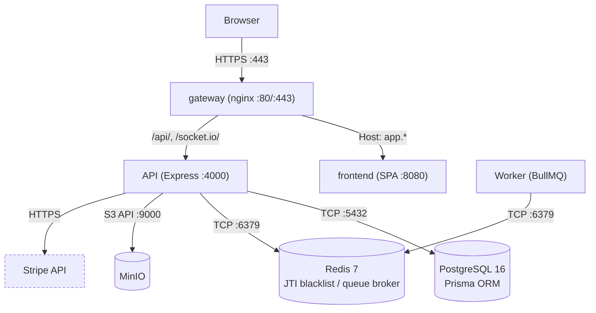
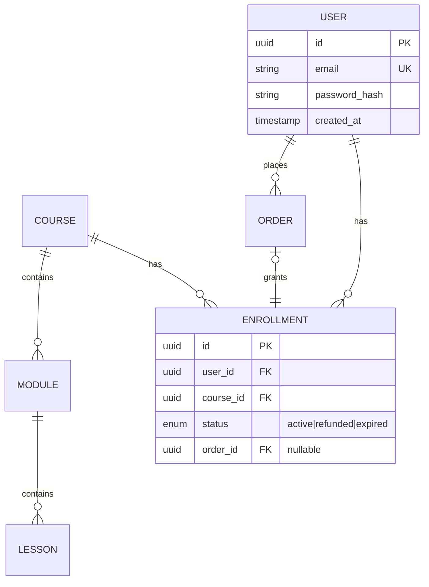
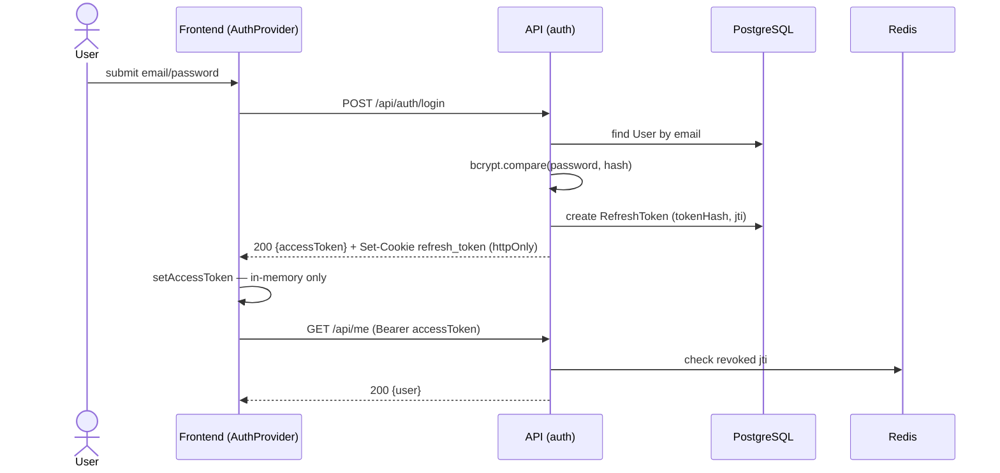
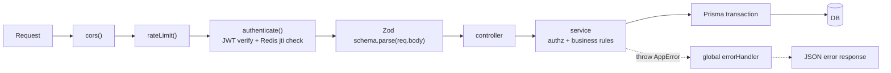
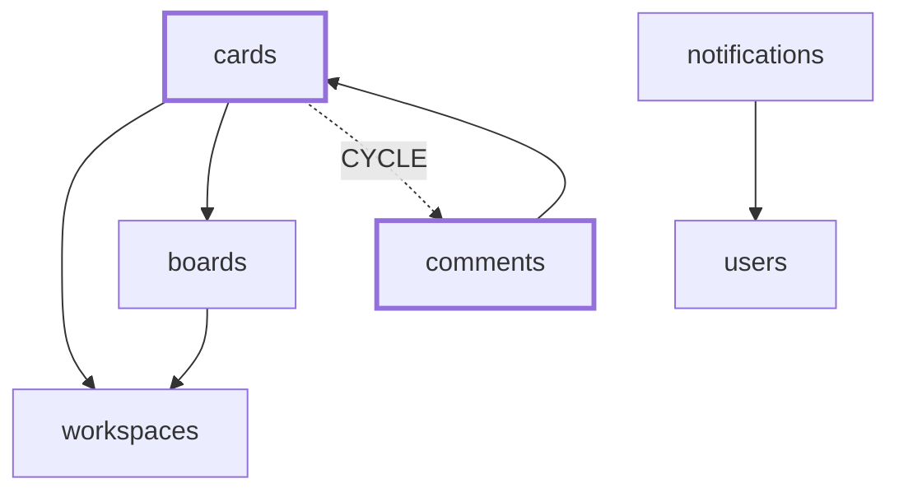
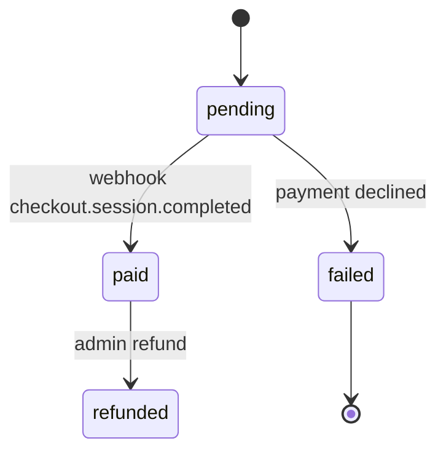

# Diagram Templates — khuôn Mermaid cho từng mục kiến trúc

Dữ liệu tham chiếu của `architect`. Đọc **một khuôn** khi vẽ sơ đồ cho mục đó — không nạp cả file.
Mọi sơ đồ dùng khối ```` ```mermaid ```` (GitHub render sẵn; VS Code cần extension Markdown Preview
Mermaid Support). Ràng buộc: `../../_shared/rules/architecture-integrity.md` §1 — **mọi node/cạnh phải
tương ứng thứ có thật** ở mode `document`, hoặc gắn `[chưa quyết]` ở mode `blueprint`.

## Quy tắc chung (áp cho mọi sơ đồ)

- **Cạnh phải mang nhãn.** Mũi tên trần không nói gì. Nhãn = giao thức + cổng + đường dẫn:
  `-->|HTTPS :443|`, `-->|TCP :5432|`, `-->|/api/*|`. Đây là ranh giới giữa sơ đồ thật và filler.
- **Nhãn node có ký tự đặc biệt phải bọc nháy kép**: `api["API (Express :4000)"]`. Ngoặc đơn không
  bọc nháy làm vỡ parser.
- Xuống dòng trong nhãn dùng `<br/>`, không dùng `\n`.
- **Không emoji** trong sơ đồ (conventions — emoji không phải icon).
- Sơ đồ > 25 node thì tách theo miền, đừng nhồi một hình. Hình không đọc được = không có hình.
- Ở `blueprint`, node/cạnh chưa chốt vẽ nét đứt: `A -.->|chưa quyết| B`.

---

## Mục 4 — System Architecture (`flowchart`)



Bắt buộc: cổng trên mọi cạnh nội bộ · datastore dùng `[( )]` · dịch vụ ngoài vẽ nét đứt.
Nguồn kiểm chứng: `docker-compose.yml`, config gateway, biến env trỏ service.

## Mục 9 — Database (`erDiagram`)



Ký hiệu lực lượng: `||--o{` một-nhiều · `}o--o{` nhiều-nhiều · `|o--||` không-hoặc-một.
Chỉ liệt kê **khoá + trường mang ràng buộc** trong hình; trường đầy đủ để ở bảng dưới hình.
Bắt buộc kèm dưới hình: chiến lược migration · index không tầm thường · hành vi `onDelete` ·
có soft-delete hay không (nêu rõ đã grep xác nhận). ER 29 bảng thì tách theo aggregate.
Nguồn kiểm chứng: `schema.prisma` / `models.py` / thư mục migration.

## Mục 11 — Business Flow (`sequenceDiagram`)



Một sequence cho **một** use case, đặt tên đúng endpoint/hàm thật. Mũi tên đặc `->>` = request,
nét đứt `-->>` = response. Ca lỗi quan trọng vẽ bằng `alt`/`else`, đừng chỉ vẽ đường hạnh phúc.
Nguồn kiểm chứng: service layer, test e2e.

## Mục 6 — Request Flow (`flowchart LR`)



Vẽ **chuỗi middleware có thật, đúng thứ tự đăng ký**, kèm đường lỗi nét đứt. Thứ tự sai còn tệ hơn
không vẽ. Nguồn kiểm chứng: app entry (`app.js`/`main.py`) — đọc đúng thứ tự `use()`.

## Mục 12 — Dependency Graph (`flowchart`)



Chỉ vẽ khi tier `platform`. Giá trị nằm ở **chu trình và hub**, không ở việc liệt kê hết cạnh.
Lấy dữ liệu từ `understand-codebase` mode `scan`, đừng tự đếm.

## Chuyển trạng thái (`stateDiagram-v2`) — dùng cho mọi trường enum `status`



Mỗi enum trạng thái trong DB nên có một sơ đồ này — nó biến "status có 4 giá trị" thành **luật
chuyển trạng thái**, thứ AI hay vi phạm nhất khi viết code. Cạnh phải ghi **sự kiện gây chuyển**.
Chuyển bị cấm (ví dụ `paid → pending`) ghi thành một dòng dưới hình, không vẽ.
