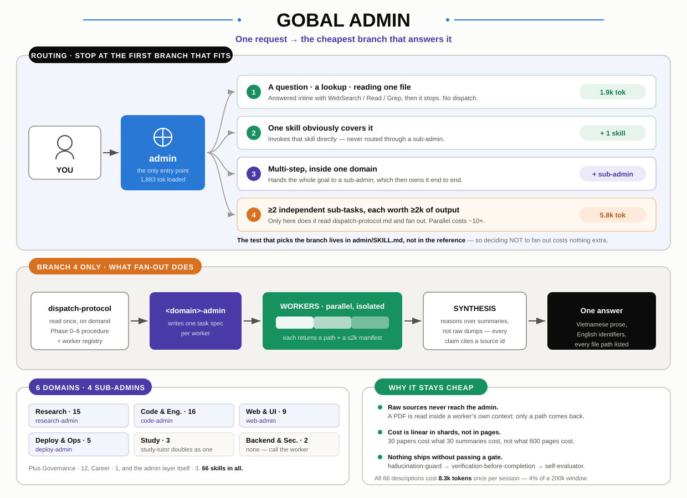

<div align="center">

# GOBAL Agent Skills

**69 specialist skills for [Claude Code](https://claude.ai/claude-code), with an Antigravity IDE distribution under verification, behind one evidence-first entry point.**


[Antigravity IDE](docs/ANTIGRAVITY.md) · [Claude Quick Start](#quick-start) · [Skills](#skills) · [Architecture](#architecture-decisions) · [Tiếng Việt](#tiếng-việt)

</div>

---

Ask for something small and you get something small. Ask for something that genuinely
needs thirty papers read in parallel, and only then does the machinery wake up:

| You say | What runs | Cost |
|---|---|---|
| `admin, RAG khác fine-tuning chỗ nào?` | Answered inline; source lookup when needed. | bounded quick lane |
| `admin, review cái diff này` | `code-reviewer`, called directly | + 1 skill |
| `admin, dựng trang pricing` | `design-web` → `build-ui`, in dependency order | requested workers |
| `admin, đọc hết papers/ rồi so sánh` | Bounded independent workers, or sequential fallback | measured per run |

Skills bundle instructions and companion resources; executable workers declare optional runtime
dependencies. Shared rules hold common policy, including a concise evidence-first invariant.
Replies come back in Vietnamese; code and identifiers stay English. Source existence is not
claim support, and a copied file is not proof of IDE activation.

---

## How It Works


The decision that picks a branch lives in `admin/SKILL.md` itself, not in the reference
file — so choosing **not** to fan out costs nothing extra. Force either way with
`admin nhanh <task>` or `admin sâu <task>`.

---

## Quick Start

This section is for **Claude Code**. For Antigravity IDE use the [Windows-first guide](docs/ANTIGRAVITY.md),
which distinguishes current/legacy IDE paths, pilot, rule activation and full rollout gates.

```bash
git clone https://github.com/VoDucNhatku/gobal-agent-skills.git
cd gobal-agent-skills

# Install globally — available in every project
cp -r .claude/skills/. ~/.claude/skills/
cp -r .claude/rules/.  ~/.claude/rules/

# Optional structural validation (Python 3.11+, pinned PyYAML)
python -m pip install -r ~/.claude/skills/test-framework/requirements.txt
python ~/.claude/skills/test-framework/scripts/test_skills.py --skills-root ~/.claude/skills --host canonical
```

Then just talk to it:

```
admin, tôi muốn nghiên cứu AI cho bài toán dự đoán học sinh bỏ học
```

**Requirements:** Claude Code or Antigravity IDE (use the matching guide), Git. Validation and Python workers need Python 3.11+ plus declared dependencies. `pdflatex`/MiKTeX is needed only for the
TikZ and PDF skills, Modal only for GPU deploys — both optional.

---

## Skills

Skills marked **`DEPRECATED`** are kept as thin redirect stubs (not deleted) so old references don't break — they point to the skill that absorbed them.

### Admin Layer (3)

| Skill | Description |
|-------|-------------|
| `admin` | The one entry point. Cheap requests (a question, a lookup, one file) are answered inline; only genuinely multi-step goals get classified, routed to a domain admin, or fanned out. Loads `references/dispatch-protocol.md` **only** when it actually fans out |
| `workbench-admin` | `DEPRECATED` → `admin` (its Phase 0–6 procedure now lives in `admin/references/dispatch-protocol.md`) |
| `skill-router` | `DEPRECATED` → `admin` (mode `classify`/`route`) |

**What decides the branch is the number of independent sub-tasks, not how much you
type.** "Explain X thoroughly, with an example and the formula" is verbose but still one
task, so it stays on the fast path; "read everything in `papers/`" is three words and
thirty independent ones, so it dispatches. Detail helps `admin` classify correctly and
avoids the clarifying-question branch — it does not by itself buy a fan-out.

`admin` and `workbench-admin` used to duplicate routing instructions. Detailed dispatch
now lives in an on-demand reference, so a narrow request need not load it. Historical
prompt-size estimates are not measurements of the new Gemini workflow's cost or speed;
those require comparable runtime traces before claiming a saving.

### Research & Academic (15)

| Skill | Description |
|-------|-------------|
| `research-admin` | Owns the full academic pipeline — `scope` (domain problem → candidate technique families, before any papers exist) → triage → shard deep-reads → merge → knowledge graph → synthesis → self-check |
| `paper-triage` | Ranks every paper by relevance (0–5) from an abstract-level pass → reading plan + next skill |
| `paper-read` | Reads ONE paper at chosen depth: `gist` / `summary` / `eli5` / `mindmap` / `think` (argument map + ablation causality + what-would-falsify) |
| `paper-method` | Deep method analysis: `critique` (formulation, math, novelty, ablation causality, 6-criterion reproducibility) or `recipe` (reimplementation pipeline table) |
| `paper-synthesize` | Cross-paper: `compare` / `taxonomy` / `gaps` / `expand`, with a claim-conflict ledger when ≥3 papers disagree (never auto-reconciled) |
| `paper-storytelling` | Restructures a manuscript into IEEE/Springer storytelling form + a compile-verified 2-row pipeline figure + Algorithm walkthrough |
| `knowledge-graph` | Typed entity–relation graph per paper, merged into a cumulative project graph, edges tagged `primary`/`secondary`/`inferred` |
| `latex-fix` | Repairs math so it renders on both KaTeX (VS Code) and MathJax (GitHub) — flags only the offending spans |
| `latex-math-renderer` | `DEPRECATED` → `latex-fix` |
| `latex-tikz-generator` | Generates TikZ vector diagrams (pipeline / block-architecture / attention-heatmap / training-curve) from compile-verified skeletons |
| `vi-translate` | Faithful Vietnamese academic translation, term-first fidelity + glossary |
| `paper-submission` | Drafts/formats manuscripts for a target venue (IEEE/CVPR/Springer); `rebuttal` mode with a concern→evidence matrix |
| `citation-guard` | DOI verification (CrossRef), orphan-citation detection, Related-Work synthesis-quality scan |
| `style-humanizer` | Reduces AI-writing signatures via a heuristic checklist under a meaning-preservation invariant; includes a PDF pagination-budget check |
| `ieee-q1-devil-advocate` | Simulates a harsh IEEE Q1 reviewer — novelty tier, ablation rigor, rejection-pattern analysis (no fabricated percentages) |

### Code & Software Engineering (17)

| Skill | Description |
|-------|-------------|
| `code-admin` | Coordinates understand → plan → implement → review → verify for code tasks |
| `scaffold-project` | Designs folder structure + team git workflow scaled to team size; `plan` (default), `apply`, `publish` (secret-scan gated), `audit`, `onboard` |
| `code-senior` | Implements/debugs/reviews with an anti-runaway-edit contract + verification gate; gated **Algorithm Justification** step for non-trivial algorithms (complexity, provenance, correctness, edge cases) |
| `understand-codebase` | Maps an unfamiliar repo into a token-bounded structural summary |
| `code-reviewer` | 6-axis severity-coded review — tests reviewed first, then implementation |
| `debug-investigator` | Root-cause-first: investigate → pattern → hypothesis → fix. Never fixes without a falsifiable hypothesis |
| `spec-writer` | Structured requirement specs with a gated review step |
| `tdd-enforcer` | Strict RED → GREEN → REFACTOR, plus property-based & mutation testing for critical/mathematical paths |
| `paper-to-notebook` | Turns a paper into a runnable notebook; `run-results` mode delta-flags reproduced numbers vs. the paper (match/close/diverge/missing — never rounded) |
| `brainstorming` | Explores intent, requirements, and design BEFORE any implementation (hard gate) |
| `domain-modeling` | Designs entities, value objects, and aggregates from business requirements |
| `writing-plans` | Breaks an approved design into small, independently-verifiable implementation steps |
| `executing-plans` | Executes a written plan task-by-task, with drift detection (STOP-and-REGAIN) |
| `finishing-a-development-branch` | Structured options to merge / open a PR / clean up once work is done |
| `using-git-worktrees` | Isolated worktrees for parallel feature development |
| `requesting-code-review` / `receiving-code-review` | Protocol for asking for and acting on a code review well |
| `test-framework` | Meta-validator — checks the skill suite itself for structural/behavioral regressions |

### Web & UI (9)

| Skill | Description |
|-------|-------------|
| `web-admin` | Routes web/UI requests through design-web → build-ui → review-frontend |
| `design-web` | Decides a theme-neutral visual direction (anti-slop token system), renders an HTML Artifact preview, locks a design-record |
| `build-ui` | Builds accessible, on-brand components / pages / admin dashboards from a locked design-record |
| `build-admin-dashboard` | CRUD admin surfaces with server-side role-gated access + analytics |
| `scaffold-course-platform` | Scaffolds a course-selling/LMS project skeleton on the binding course domain model |
| `review-frontend` | 8-dimension anti-slop + accessibility (WCAG 2.2 AA) + AI-tell audit |
| `fullstack-builder` | Scaffolds and implements a fullstack feature end-to-end |
| `design-ui-direction` | `DEPRECATED` → `design-web` |
| `build-ui-component` | `DEPRECATED` → `build-ui` (mode `component`) |

### Backend & Security (2)

| Skill | Description |
|-------|-------------|
| `backend-engineer` | Contract-first API/service design + implementation; security-boundary hardening pass |
| `security-review` | STRIDE threat model + OWASP-style severity-coded review |

### Study & Learning (5)

| Skill | Description |
|-------|-------------|
| `study-tutor` | Adaptive tutor — assesses level, then `explain` / `practice` / `quiz` / `summarize`; reuses existing `notes/` distillates before re-reading sources |
| `concept-explainer` | Explains one concept at the right depth: `eli5` / `deep-dive` / `analogy` |
| `knowledge-quiz` | Generates and administers rigorous quizzes with anti-slop distractor rules |
| `study-forge` | Print-quality study handbook from slides/PDF/code — fixed 10-cell cards, real pgfplots graphs, TikZ flowcharts; PDF/Markdown/HTML |
| `claim-forge` | Print-quality critical-reading handbook for argument-bearing documents (economics, social science, policy, law) — one falsifiable claim per card, evidence tier, load-bearing assumptions, strongest counter-reading |

### Deploy & Ops (5)

| Skill | Description |
|-------|-------------|
| `deploy-admin` | Coordinates validate → ship → monitor → rollback; owns the canonical Advance/Hold/Roll-back threshold table |
| `ship-validator` | Pre-ship gate — lint / types / tests / security / Core Web Vitals (INP ≤ 200ms) |
| `monitor-setup` | Sets up RED/USE metrics, structured logging, alerting rules |
| `rollback-manager` | Decision matrix + structured 5-step emergency rollback |
| `run-on-modal` | Deploys a paper's code to Modal serverless GPU with VRAM profiling + cost estimate |

### Career (1)

| Skill | Description |
|-------|-------------|
| `ai-cv-forge` | Builds a CV/profile for new-grad AI students, calibrated to 2025–2026 hiring signals (agentic AI, eval, RAG, MLOps, LLM infra) |

### Governance & Quality (12)

| Skill | Description |
|-------|-------------|
| `artifact-manager` | Indexes/tracks file artifacts; reuse-before-read check with a 4-level staleness table (absorbed `reuse-checker`) |
| `audit-log` | Append-only log of the 1–3 *material* decisions per session — never full transcripts |
| `project-memory` | Persists project context (decisions / preferences / known-issues / progress) across sessions |
| `learnings-db` | Captures and queries lessons learned — success / failure / discovery / correction |
| `token-budget` | Estimates and tracks token cost; overflow strategies |
| `context-compressor` | Compresses context when approaching limits (summarize / offload to file / progressive disclosure) |
| `reuse-checker` | `DEPRECATED` → `artifact-manager` (mode `reuse`) |
| `hallucination-guard` | Scans for fabricated claims/citations/metrics; mandatory re-scan-after-fix loop |
| `verification-before-completion` | The final done-gate — Iron Law + a rationalization-pattern table |
| `self-evaluator` | 4-dimension quality check before delivery |
| `writing-skills` | Meta-guidance for authoring high-quality Claude Code skills |

---

## Recent Changes

**2026-10 — Antigravity evidence-first work in progress.** Strict schemas, parser packaging,
normalization, source/claim contracts, deterministic generated output and a reversible pilot
are under verification. [Preflight review](notes/review-antigravity-preflight.md) records the
known gaps. Historical figures below are not current Gemini accuracy, latency or cost measurements.

**2026-08 — orchestrators renamed to admins, and the entry point made cheap.** The rename
was the easy half; the audit under it found a skill that could never be invoked, a binding
rule file naming three dead skills, and a validator that was wrong in both directions.

<details>
<summary><b>Full 2026-08 audit</b> — what broke, what the validator missed, and the numbers</summary>
<br>

- **Rename:** `gobal-orchestrator` → **`admin`**; the domain orchestrators → `research-admin`, `code-admin`, `web-admin`, `deploy-admin`. Directories, frontmatter, every routing table and cross-reference moved together.
- **Real bug found and fixed:** `paper-triage` declared `name: reading-triage`, so it did not match its own directory — every routing table calling `paper-triage` would have missed. The suite's own validator never caught it because it checked kebab-case but not `name` vs. directory. Both checks (`name == dir`, `description ≤ 1024 chars`) are now in `test_skills.py`, and they fail hard rather than warn.
- **Merge without inflating the entry point:** `admin` and `workbench-admin` shared 87 of 174 identical lines. Rather than concatenating them, the heavy dispatch machinery (worker registry, Phase 0–6, corpus pipeline, context specs) moved to `admin/references/dispatch-protocol.md`, read only on a real fan-out. Cheap `admin` calls went 2.5k → 1.9k tokens; `workbench-admin` became a redirect stub.
- **Stale claims corrected:** `web-admin` listed `build-admin-dashboard` and `scaffold-course-platform` as absorbed aliases — both are live, independent skills with their own `references/`. `.claude/skills/README.md` still advertised 11 skills and called deprecated names; it now points at this file instead of maintaining a second list.
- **Housekeeping:** `PLAN.md` and the 77 KB `ecosystem-research.md` existed as byte-identical copies in two places — the root duplicates were removed, keeping the ones that actually ship to `~/.claude/skills/`. `ai-cv-forge` (the one skill failing validation) had its market-strategy section moved to `references/`, putting it back under the 500-line cap.

**The validator was lying in both directions.** It reported 204 warnings; 3 of its 5 warning classes were the check's fault, not the skills':

| Class | Count | Verdict |
|---|---|---|
| `cross_refs` | 48 | Matched *any* backticked token, so modes (`implement`), enum values (`verified`), LaTeX macros (`tikzpicture`), even `and` all read as broken skills. Rewritten to read only wiki links, `→ \`skill\`` handoffs, and Cross-References sections — 48 noisy hits became **2 real ones**, both dangling: `writing-plans` → a skill that never existed here, `writing-skills` → a directory that was deleted. It also excluded `test-framework` from the valid-name set, so referring to it looked broken. |
| `announce_line` | 58 | Grepped the literal English `"I'm using the ..."` — a convention from the six imported obra/superpowers skills that the other 58 (written in Vietnamese) never adopted. Enforcing it was flagging a language mismatch as a defect. Removed. |
| `provenance` | 37 | Demanded `> **Source:**` from every skill, including original ones with nothing to attribute — inventing a source to satisfy a linter is the exact fabrication these skills forbid. Now required only where a skill *claims* an upstream. Two that did claim one in prose (`code-senior`, `backend-engineer`) were missing the marker and got it. |
| `description_format` | 55 | Demanded the literal "Use when...", while this suite uses `Triggers — <bilingual keywords>`. The check now accepts both and exempts DEPRECATED stubs — but 24 skills genuinely had neither, so they got real trigger keywords. |
| `frontmatter` | 6 | Genuine. Six skills were missing `argument-hint` or `allowed-tools`; both were filled in from what each skill actually does. |

Result: **0 failures, 0 warnings, 100% pass** — and the loosened checks were re-verified by fault injection (a mismatched `name`, a dangling reference, an oversized description each still fail).

**Session baseline**, the descriptions loaded before you type anything: 7,897 → 8,269 tokens. The 24 new trigger lists cost ~900; moving `Source: ...` attribution out of 28 descriptions and into the body markers that already held it gave back ~570. Net +372 tokens for routing that no longer has to guess.

**2026-08-06 update — three skills added, baseline re-measured in tokens, not characters.** `claim-forge`,
`study-forge`, and `scaffold-project` joined the suite, bringing it to 69. Re-auditing surfaced a real bug in
the length gate itself: `description_length` capped at 1024 **characters**, but the router pays in **tokens**,
and Vietnamese-heavy prose tokenizes far worse than English (2.6 chars/token vs. 4.0 for the English-prose
skills). `claim-forge` at 919 characters — comfortably under the character cap — was costing 413 tokens, the
single most expensive description in the suite. Rewrote both new Vietnamese-prose skills to the pattern the
other 62 already use — English prose, Vietnamese trigger list — without touching a single trigger keyword:
`claim-forge` 413 → 256 tok, `study-forge` 373 → 249 tok. New baseline: **9,042 tokens** for 69 skills
(9,323 before the rewrite). The character-based gate is still a known gap; token-based measurement was done
by hand this pass, not wired into `test_skills.py` yet.

</details>

<details>
<summary><b>Earlier: the 2026-07 audit pass</b></summary>
<br>

A full audit pass (2026-07) verified every skill's actual file content against its own claims — not just a self-report — and fixed what didn't hold up:

- **Deduplication:** 4 redundant skills (`skill-router`, `reuse-checker`, `design-ui-direction`, `build-ui-component`) — and, in 2026-08, a 5th (`workbench-admin`) — converted to thin `DEPRECATED` redirect stubs; every routing table that still called them by name was updated to point at the real owner.
- **Root-cause fix:** a hardcoded `/tmp/...` spec-file path (breaks on Windows) traced back to the shared `workbench-conventions.md` rule, not just one skill — fixed at the source and propagated to all 4 skills that used it.
- **New capability:** `research-admin` gained a `scope` mode — domain problem → candidate AI technique families + search keywords, for when you have an idea but no papers yet.
- **New capability:** `paper-read` gained a `think` mode (argument map, ablation causality, implicit assumptions, what-would-falsify) and a new `paper-storytelling` skill for IEEE/Springer manuscript structure + figure generation.
- **New capability:** `code-senior` gained an Algorithm Justification Gate (complexity, provenance, correctness idea, edge cases) so an algorithm choice can't be "fabricated" the same way a fake benchmark number can.
- **Verified, not just described:** `latex-tikz-generator`'s 4 diagram skeletons were previously prose-only; they're now real `tikzpicture` code, compile-tested with `pdflatex` before being committed.
- **Consistency fixes:** duplicate numbering, a stale "5-criterion" reference after a 6th criterion was added, a self-contradictory devil's-advocate rule, and a copy-pasted threshold table between two deploy skills.

</details>

---

## Architecture Decisions

### Why a hierarchy of admins?

```
Single big skill   → hard to maintain, low token efficiency
Many flat skills   → hard to route, no context sharing

Solution: Hierarchical admins
  admin → <domain>-admin → worker skills
```

### Token economy (5 principles)

1. **Progressive disclosure** — metadata (~100 tok) → body (<500 lines) → `references/` on demand
2. **Fan-out judiciously** — independent work shares one request budget; actual cost is measured, not a fixed multiplier
3. **Preview-not-dump** — chat = 5–10 lines + file paths. Full content lives in files
4. **Reuse-before-read** — check `INDEX.md` + existing artifacts before ingesting sources
5. **Context isolation** — each worker gets ONLY its spec. The admin never sees raw PDF text

### Hallucination defense (tiered, not one mega-skill)

| Gate | Trigger | Domain |
|------|---------|--------|
| `hallucination-guard` | Always — scan for fabrications | Research, general |
| `verification-before-completion` | Before claiming "done" | All |
| `self-evaluator` | Before delivery | All |
| `artifact-manager` (mode `reuse`) | Before creating a new artifact | All |
| Stop-Regain Protocol | The moment a hallucination is caught | All |

**Why tiered?** Different domains carry different risks. Research has cross-source risk → `hallucination-guard` + `audit-log` + `citation-guard`. Code has a "fabricated method" risk → the Algorithm Justification Gate. Tiered gates are cheaper and more precise than one catch-all skill.

---


<br>

---

# Tiếng Việt

## Giới thiệu

GOBAL Agent Skills gồm 69 skill chuyên môn và 7 file quy tắc dùng chung. Nguồn canonical dành cho Claude Code; bản Antigravity IDE có bundle và hướng dẫn cài riêng, đang qua kiểm chứng. Bạn có thể yêu cầu bằng tiếng Việt.

Bạn gọi một cửa duy nhất là `admin`; nó chọn phạm vi xử lý và giới hạn thao tác phù hợp:

| Bạn gõ | Chạy gì | Tốn |
|---|---|---|
| `admin, RAG khác fine-tuning chỗ nào?` | Trả lời trực tiếp; tra nguồn khi cần | lane có giới hạn |
| `admin, review cái diff này` | Gọi thẳng `code-reviewer` | + 1 skill |
| `admin, dựng trang pricing` | `design-web` → `build-ui` theo dependencies | worker phù hợp |
| `admin, đọc hết papers/ rồi so sánh` | Chia việc độc lập trong budget chung; fallback tuần tự | cần đo từng lượt |

Chọn độ sâu: `admin nhanh <việc>` (không worker) · `admin sâu <việc>` (nghiên cứu sâu khi cần, không bắt buộc song song). Chưa có số đo thực thì không hứa tiết kiệm token hay thời gian.

## Cách hoạt động — cho người không rành code

### Tương tự một công ty nhỏ

```
Bạn (Giám đốc)
    │
    ▼
admin (Trợ lý điều phối gốc)
    ├── "Cần đọc bài báo?"      → Phòng Nghiên cứu
    ├── "Cần code?"              → Phòng Kỹ thuật
    ├── "Cần thiết kế web?"      → Phòng Thiết kế
    ├── "Cần deploy?"            → Phòng Vận hành
    └── "Cần học tập?"           → Phòng Học tập
```

Mỗi "phòng ban" có Trưởng phòng (`<domain>-admin`) và nhiều chuyên gia (worker skill). Sơ đồ dưới đây là đúng luồng thật (đã dịch nghĩa các nhãn, tên riêng giữ tiếng Anh vì đó là tên skill thật):



Ví dụ khi bạn nói *"nghiên cứu các bài báo về AI, so sánh phương pháp, tìm khoảng trống"*: GOBAL phân loại là Research → route sang `research-admin` → chạy `paper-triage` 1 lần (chỉ đọc title + abstract, ra 5 bài liên quan nhất) → chia thành các batch đọc song song (mỗi batch chỉ trả về ≤2k ký tự tóm tắt + đường dẫn file, không trả nguyên PDF) → gom vào `notes/INDEX.md` + chạy `hallucination-guard`/`self-evaluator` → trả bạn kết quả cuối: 5 bài liên quan nhất, phương pháp chính, khoảng trống, và đường dẫn từng file.

### Sơ đồ cây skill

*(Nhóm theo chức năng cho dễ hình dung — trên đĩa thì mọi skill nằm phẳng trong
`.claude/skills/<tên-skill>/`, không có thư mục con theo nhóm.)*

```
gobal-agent-skills/
├── admin-layer/           ← Điều phối gốc (3 skills)
├── research/              ← Nghiên cứu (15 skills)
├── code/                  ← Kỹ thuật (16 skills)
├── web-ui/                ← Thiết kế web (9 skills)
├── backend/               ← Backend & bảo mật (2 skills)
├── study/                 ← Học tập (3 skills)
├── deploy/                ← Vận hành (5 skills)
├── career/                ← Sự nghiệp (1 skill)
└── governance/            ← Kiểm soát chất lượng (12 skills)
```

*(5 trong số này là "stub" đã deprecated — vẫn giữ file để không vỡ tham chiếu cũ, nhưng chỉ trỏ sang skill đã gộp: `skill-router`→`admin`, `reuse-checker`→`artifact-manager`, `design-ui-direction`→`design-web`, `build-ui-component`→`build-ui`, `workbench-admin`→`admin`.)*

### Mỗi nhóm skill làm gì — giải thích đời thường

**Điều phối gốc:**
- **admin:** Điểm vào duy nhất. Hỏi nhanh / tra cứu / đọc 1 file → nó trả lời thẳng
  (~1.4k token). Chỉ việc nhiều bước mới phân loại → gọi sub-admin, và chỉ khi cần chạy
  song song mới nạp `dispatch-protocol.md`. Gọi `admin` hỏi câu nhỏ vẫn là câu nhỏ
- **workbench-admin:** `DEPRECATED` → gộp vào `admin`. Quy trình Phase 0–6 nay nằm ở `admin/references/dispatch-protocol.md`, chỉ đọc khi thật sự fan-out

**Nghiên cứu (15 skills):**
- **research-admin:** Quản lý toàn bộ pipeline — kể cả mode `scope` mới: có ý tưởng domain mà CHƯA có bài báo nào → gợi ý nhóm kỹ thuật AI + từ khóa tìm kiếm trước
- **paper-triage:** "Đống bài báo này — cái nào đáng đọc?" (quét abstract → điểm 0–5)
- **paper-read:** "Đọc bài báo số 003" — 5 mức: gist/summary/eli5/mindmap/**think** (bản đồ lập luận + chuỗi nhân quả ablation)
- **paper-method:** "Phân tích sâu — tái lập được không? điểm mới gì?" (critique 6 tiêu chí + recipe pipeline)
- **paper-synthesize:** So sánh nhiều bài — khi ≥3 bài mâu thuẫn nhau thì ghi rõ "chưa giải quyết", không tự hòa giải giả
- **paper-storytelling:** Viết lại bản thảo theo cấu trúc kể chuyện chuẩn IEEE/Springer + vẽ pipeline figure đã compile thử
- **knowledge-graph:** Đồ thị tri thức, mỗi cạnh gắn nhãn độ tin cậy primary/secondary/inferred
- **latex-fix:** Sửa công thức toán để hiện đúng trên cả VS Code lẫn GitHub
- **latex-tikz-generator:** Vẽ hình pipeline/kiến trúc/attention/training-curve bằng TikZ — có sẵn skeleton đã compile thử thật
- **vi-translate:** Dịch bài báo sang tiếng Việt, giữ thuật ngữ chuyên ngành
- **paper-submission:** Viết bài báo theo chuẩn IEEE/CVPR/Springer; mode rebuttal có bảng đối chiếu concern↔bằng chứng
- **citation-guard:** Kiểm trích dẫn — DOI thật không, có câu mồ côi không, Related Work tổng hợp thật hay chỉ liệt kê
- **style-humanizer:** Giảm dấu hiệu văn AI, giữ nguyên số liệu/công thức/trích dẫn; có luôn bước kiểm tra dàn trang PDF
- **ieee-q1-devil-advocate:** Đóng vai reviewer Q1 khó tính — điểm mới thật không, ablation đủ chưa, không bịa % xác suất

**Kỹ thuật (16 skills):**
- **code-admin:** Điều phối hiểu → lên kế hoạch → code → review → verify
- **code-senior:** Code/sửa/review có gate chặn edit tràn lan; thêm bước bắt buộc giải trình thuật toán (độ phức tạp, nguồn gốc, edge case) trước khi code thuật toán không tầm thường
- **understand-codebase:** Giải thích dự án cũ, gói gọn trong ngân sách token
- **code-reviewer:** Review 6 trục, có phân mức độ nghiêm trọng
- **debug-investigator:** Tìm nguyên nhân gốc trước — không sửa mò khi chưa có giả thuyết kiểm chứng được
- **spec-writer:** Viết tài liệu yêu cầu, có bước duyệt
- **tdd-enforcer:** TDD nghiêm ngặt + property-based/mutation testing cho code toán/critical
- **paper-to-notebook:** Biến bài báo thành notebook chạy được; so kết quả tái lập với bài gốc theo ngưỡng match/close/diverge (không làm tròn số)
- **brainstorming:** Bắt buộc thiết kế trước khi code bất kỳ tính năng nào
- **domain-modeling:** Thiết kế entity/value object/aggregate từ yêu cầu nghiệp vụ
- **writing-plans / executing-plans:** Chia kế hoạch thành bước nhỏ kiểm tra được, rồi thực thi từng bước
- **finishing-a-development-branch:** Xong việc rồi — merge/PR/dọn dẹp theo lựa chọn có cấu trúc
- **using-git-worktrees:** Chạy nhiều nhánh song song không rối
- **requesting-code-review / receiving-code-review:** Quy trình xin và tiếp nhận code review đúng cách
- **test-framework:** Tự kiểm tra chính bộ skill có bị lỗi cấu trúc không

**Thiết kế Web (9 skills):**
- **web-admin:** Điều phối design-web → build-ui → review-frontend
- **design-web:** Chọn hướng thiết kế (chống mẫu AI-slop), preview HTML, chốt design-record
- **build-ui:** Dựng component/trang/admin thật từ design-record, có accessibility
- **build-admin-dashboard:** Trang quản trị CRUD, phân quyền server-side, có analytics
- **scaffold-course-platform:** Dựng khung dự án LMS/bán khóa học theo domain model chuẩn
- **review-frontend:** Chấm 8 chiều chống slop + accessibility (WCAG 2.2) + dấu hiệu AI
- **fullstack-builder:** Dựng trọn frontend + backend cho 1 feature

**Backend & Bảo mật (2 skills):**
- **backend-engineer:** Thiết kế API contract-first, viết code, hardening bảo mật
- **security-review:** Review theo STRIDE + rubric kiểu OWASP

**Học tập (3 skills):**
- **study-tutor:** Gia sư thích ứng — đánh giá trình độ trước, rồi giải thích/luyện tập/quiz/tóm tắt; ưu tiên dùng lại note đã có thay vì đọc lại nguồn
- **concept-explainer:** Giải thích 1 khái niệm đúng độ sâu cần
- **knowledge-quiz:** Ra quiz nghiêm túc, chống distractor dễ đoán

**Vận hành (5 skills):**
- **deploy-admin:** Điều phối validate → ship → monitor → rollback, giữ bảng ngưỡng canonical duy nhất
- **ship-validator:** Cổng kiểm tra trước khi ship (lint/type/test/security/Core Web Vitals)
- **monitor-setup:** Dựng RED/USE metrics, log, alert
- **rollback-manager:** Ma trận quyết định + quy trình rollback khẩn cấp 5 bước
- **run-on-modal:** Deploy code bài báo lên Modal GPU, ước tính VRAM + chi phí

**Sự nghiệp (1 skill):**
- **ai-cv-forge:** Dựng CV/profile cho sinh viên AI mới ra trường, theo tư duy tuyển dụng 2025–2026

**Kiểm soát chất lượng (12 skills):**
- **artifact-manager:** Quản lý + tái sử dụng file output, có bảng đánh giá độ cũ 4 mức
- **audit-log:** Ghi lại 1–3 quyết định quan trọng mỗi phiên — không ghi transcript
- **project-memory:** Nhớ ngữ cảnh dự án giữa các phiên
- **learnings-db:** Lưu bài học — thành công/thất bại/phát hiện/sửa sai
- **token-budget:** Ước tính và theo dõi chi phí token
- **context-compressor:** Nén ngữ cảnh khi sắp chạm giới hạn
- **hallucination-guard:** Phát hiện claim/trích dẫn/số liệu bịa, bắt buộc quét lại sau khi sửa
- **verification-before-completion:** Cổng "xong" cuối cùng — không được nói xong nếu chưa verify thật
- **self-evaluator:** Tự chấm 4 chiều trước khi giao
- **writing-skills:** Hướng dẫn cách viết 1 skill Claude Code cho tốt

### Tiết kiệm Token — 5 quy tắc vàng

| Quy tắc | Giải thích |
|---------|-----------|
| Preview-not-dump | Chat chỉ in 5–10 dòng + đường dẫn. File đầy đủ nằm ở `notes/` |
| Reuse-before-read | Trước khi mở PDF → kiểm tra `notes/INDEX.md`. Có rồi → dùng lại, không đọc lại |
| Mode-scaling | 1 bài → chi tiết. 10 bài → 1 dòng/bài. Tổng output tăng tuyến tính, không nổ |
| Fan-out có chọn lọc | Chỉ chia việc độc lập có lợi; admin và worker dùng chung trần thao tác, không giả định hệ số chi phí cố định |
| Script-offloading | Chỉ phát JSON spec ngắn → gọi script dựng file. Không tự tay viết boilerplate |

### Chống "Bịa" (Hallucination) — nhiều lớp phòng thủ

- **hallucination-guard:** Mọi claim cần nguồn — không nguồn là bị bắt, có vòng quét lại sau khi sửa
- **verification-before-completion:** Không được nói "xong" nếu chưa chạy verify thật
- **self-evaluator:** Tự chấm 4 chiều (hoàn thành, đúng, tiết kiệm token, không bịa) trước khi giao
- **artifact-manager (mode reuse):** Việc này đã làm rồi → dùng lại, không làm lại rồi báo là mới
- **Stop-Regain Protocol:** Phát hiện đang bịa/sai → DỪNG NGAY → nói rõ sai ở đâu → verify lại nguồn → sửa nền trước khi đi tiếp

### Phạm vi rõ ràng

Mỗi skill làm **đúng 1 việc**. Cần API → `backend-engineer`. Cần UI → `design-web` rồi mới `build-ui`. Không một skill nào ôm hết 5 việc khác nhau.

---

## Có câu hỏi?

- **GitHub:** [@VoDucNhatku](https://github.com/VoDucNhatku)
- **Issues:** [github.com/VoDucNhatku/gobal-agent-skills/issues](https://github.com/VoDucNhatku/gobal-agent-skills/issues)

**License:** MIT
